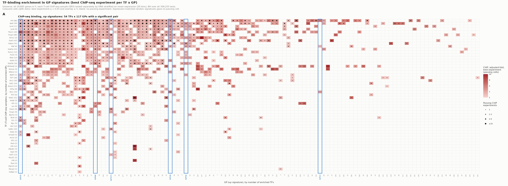
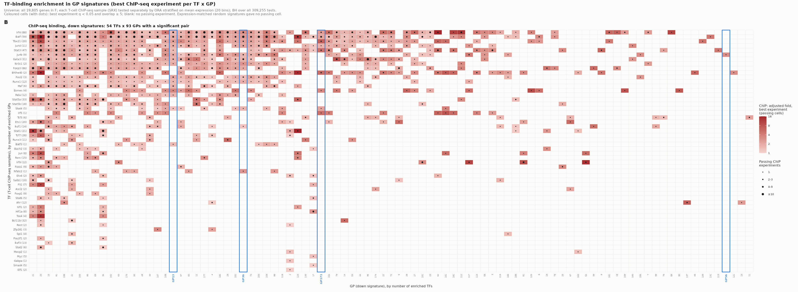

Across 200 ImmGen-T gene programs (GPs), which signatures contain more genes
bound by a transcription factor (TF) than expected for genes with similar
expression? We tested each ChIP-seq experiment separately, then summarized
the results for each TF and GP.

## Workflow

**Experiments and target genes.** We selected 1,303 mouse (mm10) primary
T-cell experiments from ChIP-Atlas, covering 143 distinct ChIP targets.
We excluded two tag or pulldown labels, two targets with incomplete data
and 62 targets classified as cofactors, chromatin regulators or other
non-sequence-specific proteins. For each experiment (SRX), we counted a gene
once if its ChIP-Atlas score was positive within 5 kb of its transcription
start site in either direction. Requiring at least five target genes among
the 19,805 genes in the factor matrix left **795 experiments for 77 TFs**.
[ChIP-Atlas target-gene data](https://chip-atlas.dbcls.jp/target_genes)

**GP signatures.** We divided each gene loading by the largest absolute
loading in its GP. Scores above 0.1 defined the positive signature and scores
below −0.1 defined the negative signature. This gave 200 positive and 189
nonempty negative signatures. We excluded the assayed TF's own gene from each
comparison.

**Enrichment.** We grouped genes into 20 bins by mean expression. Within
each bin, the expected overlap equals the number of signature genes times the
fraction of genes bound in that experiment. We summed these expectations
across bins and divided the observed overlap by that sum to obtain the
adjusted fold enrichment. We used a one-sided, expression-stratified
hypergeometric test and applied Benjamini–Hochberg correction across all
309,255 experiment–signature tests. An experiment passed for a signature
when *q* < 0.05 and at least five signature genes overlapped its targets.
One expression-matched random gene set per signature gave zero passing pairs.

```{r adjusted-fold, eval=FALSE}
# For one SRX and one GP signature, after excluding the TF's own gene.
# in_signature and bound are logical vectors over the same background genes.
bins <- split(seq_along(in_signature), expression_bin)
expected <- sum(vapply(bins, function(i) {
  sum(in_signature[i]) * mean(bound[i])
}, numeric(1)))
adjusted_fold <- sum(in_signature & bound) / expected
```

## (a) Positive GP signatures {#positive}

[](assets/ChipSeq/positive.pdf)

::: {.figcaption}
**A.** Rows are TFs (number of experiments in parentheses) and columns are GPs.
Color shows the adjusted fold of the passing experiment with the smallest
*q* (color scale capped at 16-fold). Dot size counts passing experiments
(1, 2–3, 4–9 or ≥10). A blank cell means none passed. The panel shows the
1,039 passing TF–GP pairs across 54 TFs and 117 GPs. For Foxp3 and GP68,
5 of 86 experiments passed. The selected Treg experiment (SRX184863)
had 55 overlapping genes versus 30.33 expected, giving a 1.81-fold enrichment.
:::

## (b) Negative GP signatures {#negative}

[](assets/ChipSeq/negative.pdf)

::: {.figcaption}
**B.** The same test and display applied to genes with negative GP loadings.
There were 843 passing TF–GP pairs across 54 TFs and 93 GPs. For Stat1 and
GP20, 15 of 21 experiments passed, with a 3.39-fold enrichment in the selected
experiment. The negative sign refers to the GP loadings. The assay measures
TF binding near those genes.
:::
