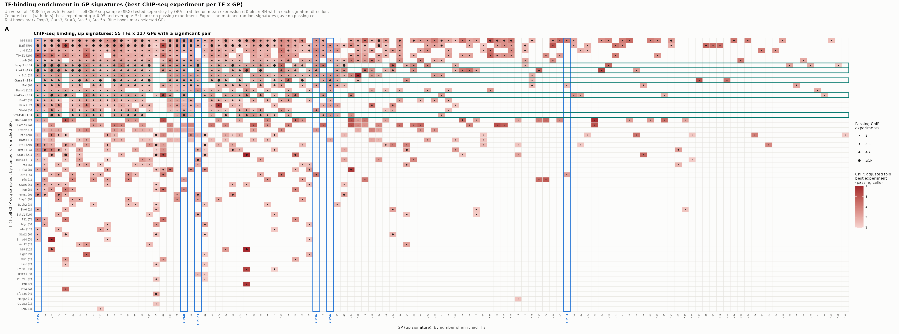
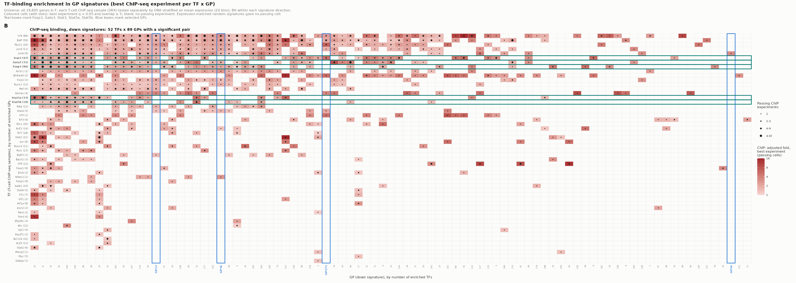
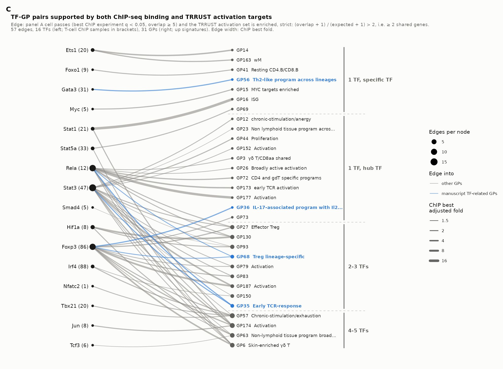

Across 200 ImmGen-T gene programs (GPs), we asked which signatures are
enriched for genes bound by a transcription factor (TF), and which of those
associations also have support from curated TF activation targets.

## 1. ChIP-seq analysis {#chip-seq-analysis}

**Experiments and target genes.** We selected 1,303 mouse (mm10) primary
T-cell experiments from ChIP-Atlas, covering 143 distinct ChIP targets.
We excluded two tag or pulldown labels, two targets with incomplete data
and 62 targets classified as cofactors, chromatin regulators or other
non-sequence-specific proteins. For each experiment (SRX), we counted a gene
once if its ChIP-Atlas score was positive within 5 kb of its transcription
start site in either direction. Requiring at least five target genes among
the 19,805 genes in the factor matrix left **795 experiments for 77 TFs**.
[ChIP-Atlas target-gene data](https://chip-atlas.org/target_genes) ·
[ChIP-Atlas publication](https://doi.org/10.1093/nar/gkag378)

**GP signatures.** We divided each gene loading by the largest absolute
loading in its GP. Scores above 0.1 defined the positive signature and scores
below −0.1 defined the negative signature. This gave 200 positive and 189
nonempty negative signatures. We excluded the assayed TF's own gene from each
comparison.

**Enrichment.** We grouped genes into 20 bins by mean expression. Within
each bin, the expected overlap equals the number of signature genes times the
fraction of genes bound in that experiment. We summed these expectations
across bins and divided the observed overlap by that sum to obtain the
adjusted fold enrichment. We used a one-sided, expression-stratified
hypergeometric test. We applied Benjamini–Hochberg correction separately
to the 159,000 positive-signature tests (795 experiments × 200 signatures)
and the 150,255 negative-signature tests (795 × 189). Within each direction,
an experiment passed for a signature when *q* < 0.05 and at least five
signature genes overlapped its targets. We repeated each analysis with one
expression-matched random gene set per signature. Neither control yielded a
passing TF–GP pair.

```{r adjusted-fold, eval=FALSE}
# For one SRX and one GP signature, after excluding the TF's own gene.
# in_signature and bound are logical vectors over the same background genes.
bins <- split(seq_along(in_signature), expression_bin)
expected <- sum(vapply(bins, function(i) {
  sum(in_signature[i]) * mean(bound[i])
}, numeric(1)))
adjusted_fold <- sum(in_signature & bound) / expected
```

### (a) Positive GP signatures {#positive}

[](assets/ChipSeq/positive.pdf)

::: {.figcaption}
**A.** Rows are TFs (number of experiments in parentheses) and columns are GPs.
Color shows the adjusted fold of the passing experiment with the smallest
*q* (color scale capped at 16-fold). Dot size counts passing experiments
(1, 2–3, 4–9 or ≥10). A blank cell means none passed. In both heatmaps,
teal boxes outline the Foxp3, Gata3, Stat3, Stat5a and Stat5b rows. Blue boxes mark
the selected GP columns. The panel shows the
1,068 passing TF–GP pairs across 55 TFs and 117 GPs. For Foxp3 and GP68,
5 of 86 experiments passed. The selected Treg experiment (SRX184863)
had 55 overlapping genes versus 30.33 expected, giving a 1.81-fold enrichment.
:::

### (b) Negative GP signatures {#negative}

[](assets/ChipSeq/negative.pdf)

::: {.figcaption}
**B.** The same test and display applied to genes with negative GP loadings.
There were 792 passing TF–GP pairs across 52 TFs and 89 GPs. For Stat1 and
GP20, 14 of 21 experiments passed, with a 3.39-fold enrichment in the selected
experiment. The negative sign refers to the GP loadings. The assay measures
TF binding near those genes.
:::

## 2. TRRUST analysis {#trrust-analysis}

Mouse TRRUST v2 curates TF–target relationships from the literature across
cell types. For each TF, we took the genes annotated as activated by that TF,
excluding pairs with conflicting directions or only unknown direction.
We compared these activation targets with the positive GP signatures.
[TRRUST v2 (Han et al., 2018)](https://doi.org/10.1093/nar/gkx1013)

Of the 55 TFs in panel A, 27 had at least five TRRUST activation targets in
our gene universe (the rows of the factor matrix *F*). Across these 27 TF
rows in panel A, 615 TF–GP pairs showed significant ChIP-seq enrichment
(one colored cell per pair). For each of these 615 pairs, we asked whether
the same GP signature was also enriched for that TF’s activation targets in TRRUST.

We counted the activation targets in the GP
signature and computed their expected overlap using the same 20 expression
bins. We drew an edge when **(observed + 1) / (expected + 1) > 2**.
This is an effect-size threshold. The *q* < 0.05 requirement applies to
the ChIP-seq experiment in panel A.

### (c) ChIP-seq binding and TRRUST activation targets {#activation-network}

[](assets/TRRUST/activation-network.pdf)

::: {.figcaption}
**C.** The 57 edges connect 16 TFs (left) to 31 GPs (right). Edge width
shows the selected ChIP experiment's adjusted fold enrichment. Node size
counts connections, and blue edges lead to highlighted GPs. For example,
three of five curated Foxp3 activation targets (*Ctla4*, *Il2ra* and
*Tnfrsf18*) were in GP68_up, compared with 0.16 expected. The resulting
TRRUST ratio of 3.44 gives Foxp3 and GP68 an edge alongside the 1.81-fold
ChIP enrichment in panel A.
:::
